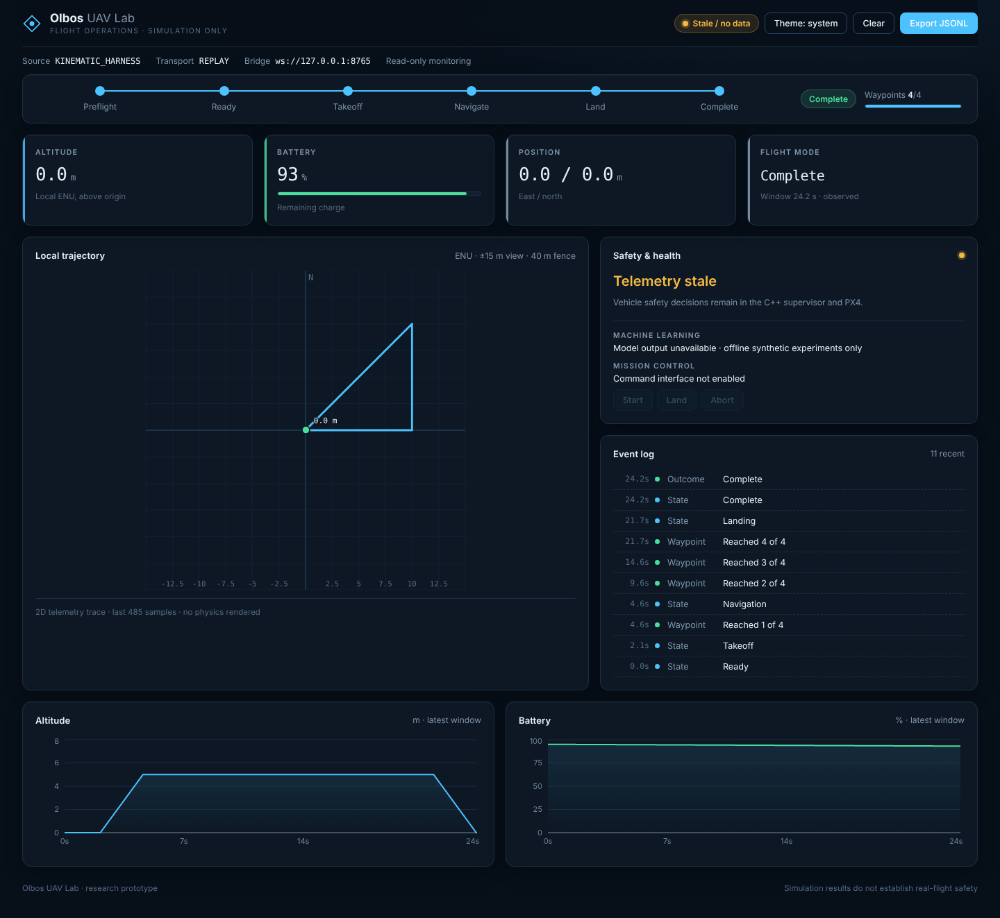

# Olbos UAV Lab

Autonomous UAV simulation and machine-learning research platform built with C++20, PX4, ROS 2, and Gazebo. MIT licensed.
**Version 0.2 — shared C++ mission architecture; PX4 SITL acceptance pending.**



The dashboard was checked in headless Chromium against harness replays (nominal and low-battery abort) in dark, light and phone layouts.

## What runs now
- Modular C++20 core: explicit ENU/NED types, independent safety supervisor, validated waypoint plans and a shared deterministic MissionController.
- Kinematic harness using the same mission engine as ROS: nominal waypoints, low battery, stale telemetry, geofence, operator abort and command rejection.
- React/TypeScript/Vite/Recharts read-only dashboard: mission phase timeline, waypoint progress, auto-zoom trajectory, altitude/battery charts, event log, stale detection, auto-reconnect, light/dark themes and JSONL export.
- Read-only WebSocket replay, plus ROS 2 live telemetry bridge source.
- Offline synthetic health detection and route energy experiments with measured evaluation reports.

## PX4 integration source
ROS 2 C++ node adapts PX4 messages to the shared core exported by the uav_core ament package. It supports heartbeat warmup, bounded requests, waypoint parameters, an abort service and completion from fresh landed/disarmed observations. Command acceptance never substitutes for observed state.
Launch/runbook targets Ubuntu 22.04 + ROS 2 Humble + PX4 v1.16.0 + Gazebo Harmonic.
This adapter has **not been compiled or flown in SITL in the initial environment**. ROS/PX4/Gazebo are absent.
It must pass target-host acceptance before being called a working PX4 simulation MVP.

```bash
bash scripts/test_core.sh
bash scripts/run_demo.sh
python3 -m unittest discover -s tests/integration -v
```
Full execution commands, expected output and blockers: [installation](docs/installation/setup.md).

## Mission architecture and testing
The ROS adapter and kinematic plant both consume `MissionController::tick()` decisions. Safety checks precede
active flight decisions; cancellation is latched, and stale landing observations cannot produce successful completion.
The default ROS configuration remains an ascent/land smoke test; `config/waypoint-mission.yaml` adds a short waypoint route.

```bash
# With libgtest-dev installed:
cmake -S . -B build -DUAV_BUILD_GTEST=ON
cmake --build build
ctest --test-dir build --output-on-failure
```

See the [0.2 observed results](docs/testing/v0.2-results.md) for actual checks and remaining blockers.

## Engineering documentation
- [Architecture and diagram](docs/architecture/architecture.md)
- [Compatibility matrix and official sources](docs/installation/compatibility.md)
- [Interface contracts](docs/interfaces/contracts.md)
- [Safety scope and limitations](docs/safety/limitations.md)
- [Observed validation results](docs/testing/observed-results.md)
- [Phase roadmap and unfinished deliverables](docs/roadmap.md)

No real-aircraft operation, safety certification, guaranteed ML reliability or production readiness is claimed.
ML never publishes flight commands. The dashboard command interface is deliberately disabled until an acknowledged command gateway exists.
Generated datasets, trained models, build outputs, node_modules and external checkouts are ignored.
Dependencies are partially pinned; target OS package resolution remains to be captured. Repository: olbos-uav-lab (https://github.com/olbos-technologies/olbos-uav-lab)
