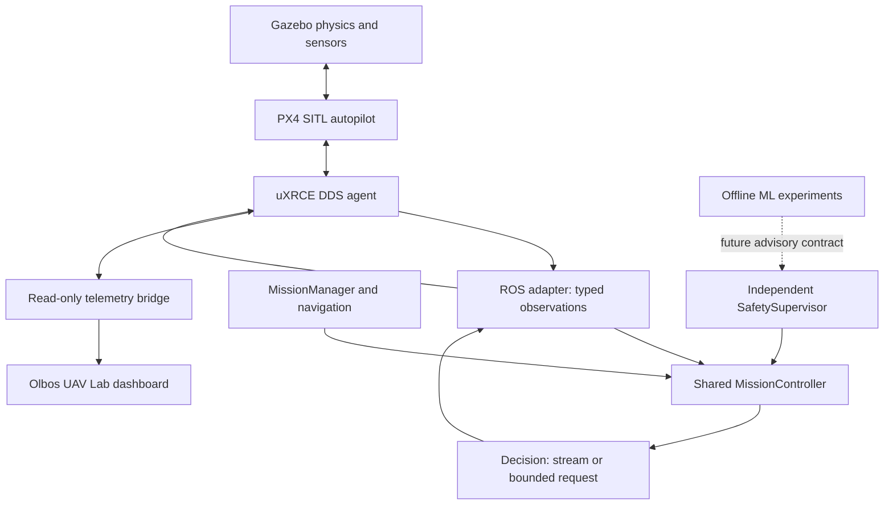
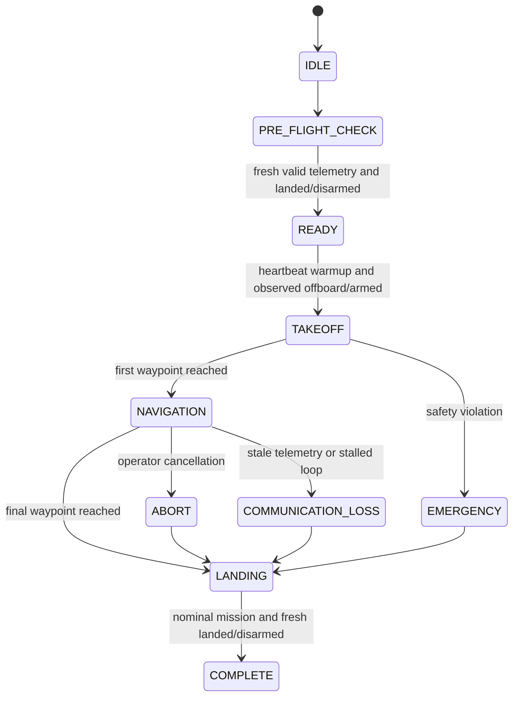

# Olbos UAV Lab architecture — 0.2

One deterministic C++ mission engine now drives both the kinematic test harness and the ROS 2 PX4 adapter.
The core runs independently of ROS, simulation physics, ML and the web interface. PX4 SITL acceptance remains pending.

| Module | Interface / file | Responsibility |
|---|---|---|
| Frame and limits | core/include/uav/types.hpp | explicit ENU/NED types, validated configuration, telemetry, fault codes |
| Navigation | navigation_controller.hpp | finite bounded trajectory increments, arrival distance |
| Mission state | mission_manager.hpp | permitted normal and exceptional transitions |
| Independent supervisor | safety_supervisor.hpp | position validity, receipt age, battery, radial/altitude fence, command envelope |
| Mission orchestration | mission_controller.hpp | preflight, warmup, observed mode/arming, waypoints, abort, landing, retry/deadline bounds |
| ROS library package | ros2_ws/src/uav_core | exports uav_core::uav_core and installed headers |
| PX4 adapter | ros2_ws/src/uav_controller | receipt timestamps, message conversion, request publication, ACK filtering, abort service |
| Harness | core/demo.cpp | consumes the same decisions using a simple deterministic kinematic plant |
| ML | machine_learning/training | synthetic health/anomaly/route experiments; no flight-command access |
| Ground interface | dashboard + scripts/*telemetry_ws.py | source-labeled live/replay read-only snapshots, mission timeline, event log and local charts |

The component headers are independent library modules, not six unnecessary concurrent ROS nodes. The named module
folders under ros2_ws/src describe their mapping. Only uav_core and uav_controller are implemented ROS packages.

## Control interface
`MissionController::tick(elapsed_seconds, Observation)` returns a `Decision` value:
- state, terminal outcome, reason and completed waypoint count;
- an optional bounded Offboard / Arm / Land request;
- whether to stream offboard heartbeat and the validated ENU setpoint.

The adapter converts ENU to PX4 NED, stamps ROS messages, and translates PX4 status into observations.
`acknowledge(request, accepted_or_in_progress)` never advances a flight state by itself.
`request_abort()` latches cancellation for the next control tick; it cannot restart the mission.
There is no ML handle, file/network call, allocation of route storage or asynchronous state mutation in tick().
Route storage is validated once at construction and bounded to 64 waypoints. Initial takeoff is vertical at the local origin.

## State and outcome semantics

Exceptional transitions are supported from other active states as well. Terminal outcomes are separate from states:
Running, Complete, AbortedLanded, Failed. A fault-induced descent never becomes nominal Complete.
Stale telemetry can cause the harness plant to reach the ground while the controller still returns Failed/LANDING_UNVERIFIED.
That difference is intentional: a presumed landing does not establish an observed landing.

## Scheduling, safety and failure ownership
The ROS node uses a single-threaded executor at 20Hz. Snapshot ownership stays inside that executor.
Before any active offboard stream or arm request, the core evaluates the independent safety supervisor.
Targets are constrained by a radial local fence/altitude envelope and bounded increments using actual elapsed time.
These are setpoint bounds, not measurements or guarantees of actual vehicle speed or obstacle clearance.
A timer gap over 0.5s stops streaming. Nonfinite/backward/repeated timestamps fail closed.
No ML inference is executed in the timing-sensitive loop.

Offboard/arm requests have three attempts, two seconds apart; Land is retried at the same interval until landing
verification times out. Commands require observed vehicle state even after accepted ACKs.
Mission deadline is 90s, each leg is limited to 30s, landing verification to 40s. These deterministic defaults live in MissionConfig;
the ROS node exposes `mission_deadline` and `leg_timeout`. Plans whose nominal legs (1.5x distance/max speed) or total
time cannot fit these bounds are rejected before flight.
Timing exhaustion, rejected commands or faults stop heartbeats. Active abort/safety faults request PX4 Land;
loss of the process/transport relies on the separately configured PX4 Land-on-offboard-loss action.
Fallback landing is still subject to PX4 validity/estimation and requires actual SITL evidence.

ROS queues are bounded (sensor depth 5, publication depth 10). WebSocket bridges run separately with bounded queues,
2s send deadlines and a latest-snapshot lock; UI retains 600 samples. Replay currently loads its whole input file.
Mission parameters come from controller.yaml; a separate waypoint-mission.yaml enables the short square mission.
The dashboard's loopback simulation demo has its own in-memory mission state and synthetic advisory output. Its commands do not reach the shared C++ controller, ROS, PX4, or a vehicle. The production/PX4 dashboard command gateway remains unimplemented. The ROS abort service reports only queued intent, not a PX4 acknowledgment or a confirmed landing.

## Remaining architecture work
Target-host ROS build/actual flight tests, estimator reset/source-timestamp handling, position-aware RTL,
obstacle clearance, runtime ML worker/ONNX parity/timeout monitoring, and an acknowledged UI command gateway remain future work.
ReturnToLaunch is an enum reservation only; no RTL execution is implemented. No real hardware support or aerospace certification is claimed.

## Dashboard structure
`dashboard/src` separates transport from presentation:
- `telemetry/types.ts` defines the sample contract and copies only known, well-typed fields from each frame.
- `telemetry/useTelemetry.ts` owns the WebSocket: bounded 600-sample window, 2 s staleness, exponential reconnect
  (0.5 s to 10 s), a new session when the source clock restarts, and the derived state/waypoint/alert event log.
- `telemetry/mission.ts` maps controller states, outcomes and alert codes to display phases and severities.
- `components/` holds stateless views (timeline, metrics, trajectory, charts, safety, event log).
The bridge URL defaults to `ws://127.0.0.1:8765`; `?ws=` may override it with another loopback address only.
Mission phases appear only when a sample carries `state`/`outcome` (harness replay). The live bridge does not yet
publish controller state, so the dashboard shows its raw PX4 nav_state instead of inferring a phase.
