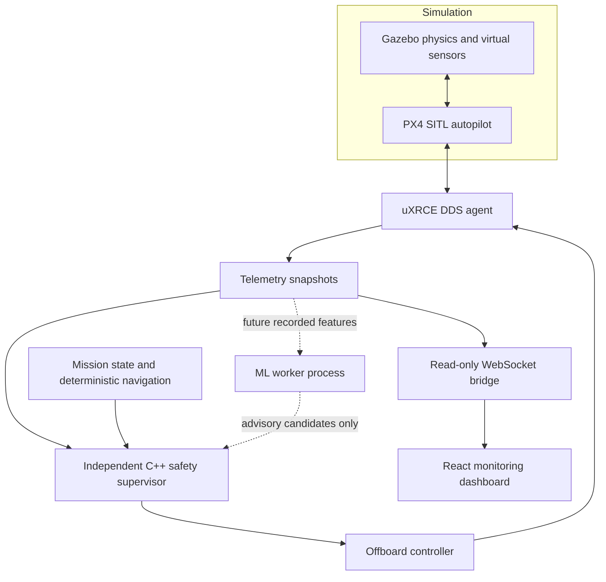

# Architecture and implementation boundary
Version 0.1: executable standalone foundation plus unverified SITL adapter. Not a completed production platform.

| Layer | Component | Current implementation | Boundary |
|---|---|---|---|
| Physics | PX4 v1.16 + gz x500 | launch script; basic SDF provided separately | requires external installation |
| Control | SitlMission ROS node | 20Hz position stream, mode/arm requests, ascent, land, observed completion | source not compiled here |
| Control | core.hpp | frame types, radial/local altitude fence, battery/freshness, FSM, bounded steps | standalone tested |
| ML | train.py | Isolation Forest, fault classifier, route regressor | offline synthetic data, no actuation |
| Ground | React + Recharts | read-only live/replay display, trace, export, stale status | no mission command API |
| Validation | harness + CI | four deterministic scenarios, core contracts, web build | no PX4 physics claims |

## Scheduling and ownership
ROS controller uses a single-threaded executor; its state is owned by that executor.
No inference, disk recording, network waits, or model loading in its timer. Telemetry bridge runs separately.
ROS queues have bounded depth (5 sensor messages / 10 publications). Bridge keeps one latest snapshot under a lock;
each WebSocket has a bounded queue and 2 second send deadline. UI retains at most 600 samples.
Replay currently reads one complete file into memory; limit input file size outside this research prototype.
The reference mission has a 90 second overall deadline, three command attempts, 30 second climb and 40 second landing limits.

## Safety precedence
1. Before offboard streaming, independently check finite/valid position, sensor receipt age, battery, current fence.
2. Validate target setpoint and cap trajectory step at 2m/s (parameterized).
3. Denied command, unexpected mode, stale receipt, or flight envelope violation latches Fault.
4. Fault stops heartbeats and requests Land if the last observed state was armed.
5. PX4's separately configured offboard-loss failsafe owns behavior if the ROS process/network disappears.
A request is not acceptance, and acceptance is not completion. Complete requires fresh landed **and disarmed** observation after arming.
Fault landing is deliberately reported unverified, not successful.

## Planned evolution
Split core into independently packaged libraries after actual SITL integration. Add typed observations with source timestamps,
EKF reset counters, geodetic origin, velocity/acceleration limits, waypoint dwelling, validated RTL, and abort service.
Current FSM is tested as a library contract but the ROS smoke mission has its own smaller state machine; a single shared FSM is Phase 2 work.
Add ML worker watchdog and numerical ONNX parity before considering route suggestions. Never grant ML direct PX4 publish access.
No aerospace certification, assurance level, real-aircraft compatibility, or production readiness is asserted.
